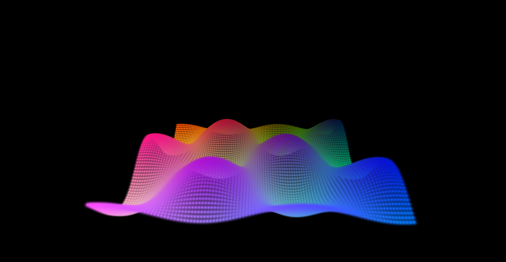
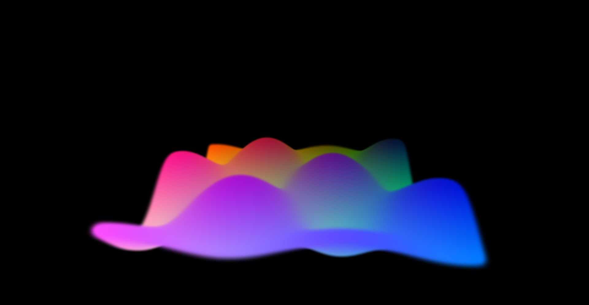
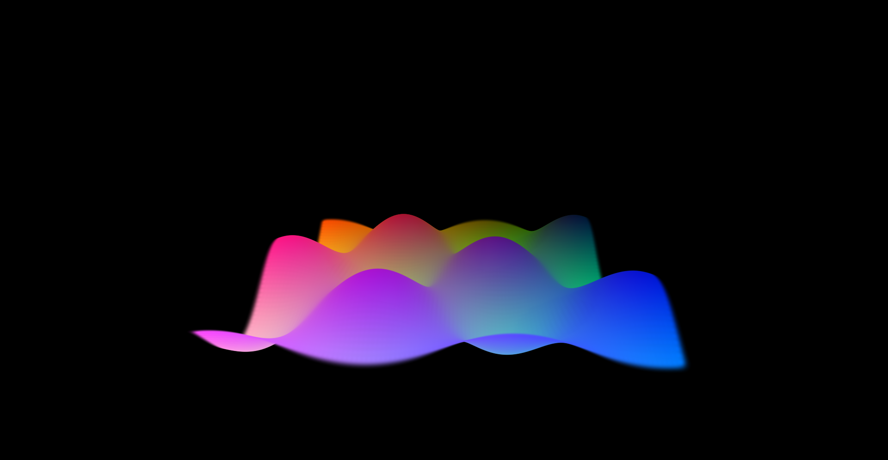

# Training-Free 3D Gaussian Splatting for RGB-D Cameras (Intel RealSense D455)

Most 3D Gaussian Splatting (3DGS) pipelines are built for photorealistic VR: you take 100 photos of a room, run COLMAP to guess the depth and camera positions,
and train a neural network for 15 minutes to learn lighting reflections, while splitting and cloning Gaussians to fill in empty spaces.

**Our goal here is completely different.** We are building a pipeline for a rover/camera setup using an **Intel RealSense D455 RGB-D camera**, 
where the priority is fast 3D mapping and obstacle reconstruction rather than shiny mirror reflections. 

Because a depth camera *already* gives us real-world depth ($Z$) for every single pixel in hardware—and gives us hundreds of thousands of dense points in a 
single snapshot—we don't need neural network training, and we don't need to split or clone Gaussians. Instead, our entire engineering focus is on 
**deterministic geometry**: sizing the Gaussians properly, tilting them along surfaces, fixing edge stretching bugs, and cutting away redundant points.

This repository documents my step-by-step progression from basic spherical splats to multi-view camera stitching, including the exact bugs we hit along the way
and how we solved them.

---

## Folder 01: `01_spherical_splats_baseline` — From Constant Spheres to Adaptive Camera Scaling

When we first convert a basic point cloud into 3D Gaussian Splats, every point is just a round 3D sphere (`scale_0 = scale_1 = scale_2`) with no rotation. 
Here we immediately run into two problems:

### Problem 1: The "Screen-Door vs. Marshmallow" Trade-off
If we want to represent a thin wavy sheet using spheres:
* **If we make the spheres small (`spheres_small.png`):** We keep sharp edges, but the surface looks like a porous screen door with huge gaps between the dots.
* **If we make the spheres big (`spheres_big.png`):** We close the gaps, but because spheres expand equally in *all* directions (including thickness),
    a thin sheet of paper puffs out into a thick, blurry marshmallow.

| Small Constant Spheres (Gaps) | Large Constant Spheres (Puffy/Blurry) |
| :---: | :---: |
|  |  |

### : So We Must Abandon Spheres for Surfels (Pancakes)
Both spherical trade-offs prove a fundamental limitation of standard 3D Gaussian Splatting: **Spheres are volumetric.** They grow equally in depth thickness as they do in width. 

* **The Fix:** To represent real-world surfaces (walls, floors, wavy terrain) without blurry marshmallows or screen-door gaps, we must stop using spherical Gaussians. 
* **The Solution — Surfels (Pancakes):** We squash the third axis (`scale_2`) down to a paper-thin $0.5\text{ mm}$ and treat every Gaussian as a flat 2D elliptical disc oriented flush against the surface. This allows us to tile them tightly together like bathroom tiles, sealing all gaps while keeping sharp, crisp boundaries.

   

### Problem 2: The Camera Cone Problem (Why Constant Scale Fails on Real Cameras)
In a synthetic grid, points are spaced evenly. But a real camera works like a flashlight cone shooting rays out from a tiny pinhole lens:
$$X = \frac{(u - c_x) \cdot Z}{f_x}, \quad Y = \frac{(v - c_y) \cdot Z}{f_y}$$
* Up close at $Z = 0.5\text{ m}$, two neighboring pixel rays hit an object right next to each other ($2.5\text{ mm}$ apart). A constant-sized Gaussian will
   be too huge and blurry here.
* Far away at $Z = 4.0\text{ m}$, those exact same two neighboring rays have spread out to $20\text{ mm}$ apart. The same constant-sized Gaussian will
  now be way too tiny, leaving massive holes in far walls.

**The Stage 01 Fix:** Instead of a constant scale, we make the Gaussian radius grow dynamically with depth ($\text{scale} \propto \frac{Z}{f_x}$). 
Close points get tiny splats for sharp detail, and far points get wider splats so walls stay solid.

### Problem 3: The "Venetian Blind" Gap Problem on Slanted Surfaces
While scaling radius by $Z/f_x$ solved the camera cone problem for walls facing the camera flat-on, it introduced a new artifact on sloped floors or waves:
* **The Issue:** We previously set both pancake axes equal (scale_0 = scale_1 = log(Z / fx)). Horizontally across columns ($u$), pixels are spaced by $\approx 2.0\text{ cm}$. However, because the rover camera views the slanted wave at a grazing angle, neighboring rows ($v$) are stretched out to $\approx 3.5\text{ cm}$ in 3D space!
* **The Result:** Circular pancakes touched left-to-right (forming solid horizontal ribbons), but were too short front-to-back, leaving 120 horizontal stripe gaps looking like Venetian blinds.

**The Anisotropic Solution (`wave_BETTER_ADAPTIVE_anisotropic.ply`):**
Instead of isotropic circular scaling, we measure the true 3D Euclidean distance to the column neighbor ($\text{dist}_u$) and row neighbor ($\text{dist}_v$) independently, and align the full 3D orthonormal rotation matrix $[e_u, e_v, \text{normal}]$:
1. $\text{scale}_0 = \log(\text{dist}_u \cdot 0.85)$ — seals horizontal column gaps.
2. $\text{scale}_1 = \log(\text{dist}_v \cdot 0.85)$ — seals vertical row-to-row gaps on steep slopes.
3. $\text{scale}_2 = \log(0.0005)$ — keeps the surfel paper-thin ($0.5\text{ mm}$) along the surface normal.

| Simple Circular Adaptive ($Z / f_x$) | Better Anisotropic 3D Distance ($\text{dist}_u, \text{dist}_v$) |
| :---: | :---: |
|  |  |
| *Notice the horizontal stripe gaps on slanted slopes* | *Solid, continuous surfels sealing all gaps* |

---

## Folder 02: `02_anisotropic_veil_and_upwind_fix` — Pancakes (Surfels), The Veil Bug, and Upwind Gradients

In `01_spherical_splats_baseline`, we got adaptive scaling working, but using spheres still couldn't solve the "thin sheet of paper" problem,
and simple $Z/f_x$ scaling leaves gaps when a surface slopes steeply away from the camera.

To fix this, we squash the thickness axis (`scale_2`) down to $0.5\text{ mm}$ so every sphere becomes a flat **anisotropic pancake (surfel)**. 
Then, we calculate the true 3D distance to each pixel's neighbor (the gradient) so we know both:
1. How wide to stretch the pancake so it touches its neighbor on steep slopes.
2. How to tilt the pancake (using surface normals `nx, ny, nz` and quaternions `rot_0..3`) so it lies flat against the slope.

**However, doing this introduced two brand-new problems:**

### Problem 1: The "Veil Bug" at Object Edges
When we set the Gaussian's scale based on the true 3D distance to its neighbor, what happens at the edge of two objects—say, a rock or chair placed at 
$Z = 1.0\text{ m}$ in front of a background wall at $Z = 3.0\text{ m}$?
* A pixel right on the edge of the rock looks at its neighboring pixel one step to the right.
* That neighboring pixel missed the rock and hit the background wall $2.0\text{ meters}$ behind it!
* Because our code checks the true 3D distance to the neighbor, it sees a massive $2.0\text{ m}$ distance and thinks the surface is stretching all the way to
  the wall. It turns that single edge Gaussian into a giant $2\text{ m}$ stretched curtain ("Veil Effect") bridging the empty air between the rock and the wall!

*(Note: There are not extra Gaussians floating in the air—it is just the single row of edge Gaussians expanding to a huge scale because the neighbor
 distance jumped!)*

| Naive Neighbor Gradient (The Veil Bug) | Upwind One-Sided Gradient + Pruning (Fixed) |
| :---: | :---: |
|  |  |

### Problem 2: How to Fix the Edge Without Losing Edge Accuracy
How do we take care of these high-gradient edge pixels? 
If we simply delete every pixel that has a high gradient next to it, we will chop off the actual physical edges of our objects and lose the boundary accuracy
we want.

**Our 2-Step Solution (`veil_bug_vs_upwind_surfels.py`):**
1. **One-Sided "Upwind" Gradients:** Instead of blindly measuring the neighbor to the right, every pixel checks *both* its left neighbor and its right neighbor,
     and picks whichever direction is smoother (the minimum of the two one-sided gradients on each axis). 
   * A steep slope is continuous and has a similar gradient on both sides.
   * A true cliff/object edge has a smooth surface on one side (back onto the rock) and a massive jump on the other side (off the cliff to the wall).
     By picking the smaller jump, the edge pixel stays flat on the rock instead of jumping across empty air to the wall!
2. **Pruning Isolated Flying Pixels:** Finally, for isolated noisy pixels floating in mid-air that have *no* close neighbor in any surrounding direction
     (even their minimum gradient is huge, $> 4\text{ cm}$), we safely cut/delete just those bad points.

---

## Folder 03: `03_multiview_object_stitching` — World Coordinates & Minimum Camera Views

Once we can capture a clean, sharp single frame with zero veil artifacts, the final obstacle is **self-occlusion**: a single camera looking at a chair or
table only sees the front, leaving black blind spots behind the legs and backrest.

### How We Stitch Multiple Views Together
Every camera is "selfish"—it measures coordinates relative to its own lens at `(0, 0, 0)`. If you combine points from 3 or 4 cameras directly, the front and 
back of the chair get drawn right on top of each other.

Since we fix our camera locations on a ring around the object, we know each camera's **Position ($\vec{t}_{\text{cam}}$)** and **Rotation Matrix ($R_{\text{cam}}$)**.
To bring every camera's local splats into one shared **World Coordinate System**, we do two things:
1. **For Splat Positions ($\vec{P}$):** We rotate them *and* shift them by the camera's location in the room:
   P_world = R_cam * P_cam + t_cam
2. **For Pancake Tilt / Tangent Vectors ($\vec{T}$):** Moving a camera across the room changes where a pancake sits, but doesn't change the angle it is tilted at—only turning the camera changes its angle. So surface tangents and normals are *only* rotated (no $+\vec{t}_{\text{cam}}$):
  T_world = R_cam * T_cam

### Cutting Overlaps: Voxel Deduplication Instead of Cloning
Because our camera already has high pixel density, when 3 or 4 cameras look at the same tabletop, they stack multiple layers of pancakes on the exact same spot.
Instead of traditional 3DGS splitting/cloning, we divide the 3D world into tiny **$8\text{ mm}$ cubes (voxels)** and keep only 1 Gaussian per cube (`np.unique`).

### Experiment: What is the Minimum Number of Views Needed?
* **1 View (`[0°]`):** Leaves huge blind spots behind the table and chair.
* **3 Views (`[0°, 120°, 240°]` — The Sweet Spot):** Three cameras spaced $120^\circ$ apart form a triangle around the object, capturing almost the entire
    3D geometry while saving 25% of the data/compute compared to 4 views.
* **4 Views (`[0°, 90°, 180°, 270°]`):** Complete 4-corner coverage.

| 1 Camera View | 3 Camera Views (120° Rig) | 4 Camera Views (90° Rig) |
| :---: | :---: | :---: |
|  |  |  |

---

## Repository Structure

* `01_spherical_splats_baseline/` — Shows constant-scale spheres vs. optical cone depth scaling ($Z/f_x$).
* `02_anisotropic_veil_and_upwind_fix/` — Demonstrates the neighbor-gradient Veil Bug at edges and fixes it using one-sided upwind gradients + flying-pixel pruning.
* `03_multiview_object_stitching/` — Simulates multi-angle RGB-D capture of a table & chair scene, transforms splats and normals into World coordinates,
   and deduplicates overlaps on an 8mm voxel grid.
* `src/rgbd_to_splat.py` — Core converter script that packs outputs into the full **62-property binary `.ply` layout**
  (`x,y,z`, `nx,ny,nz`, `f_dc_0..2`, `f_rest_0..44`, `opacity`, `scale_0..2`, `rot_0..3`) required by strict viewers like **SuperSplat**.

## How to Run & View

1. **Install dependencies:**
   ```bash
   pip install -r requirements.txt
